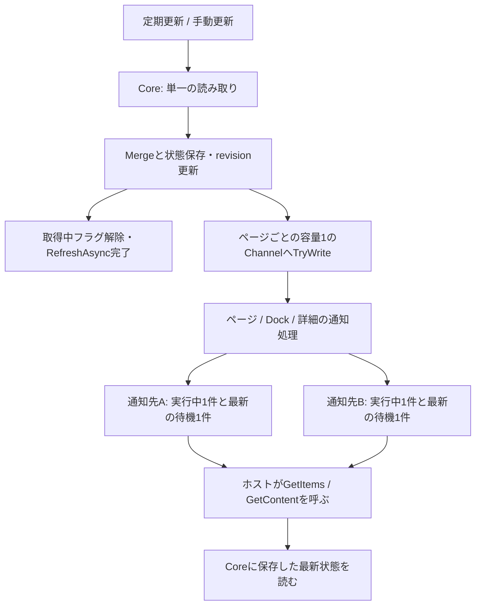

# テレメトリの取得・保存・通知

2026-10-21の構造変更。対象はCoreの状態保存とCmdPalのページ・Dock・詳細画面。

## 変更前に停止が伝わる経路

```text
定期タイマー／手動更新
  → ReadSnapshot → Merge → 状態保存
    → StatusChangedの同期呼び出し
      → ページのCOM通知
      → DockのCOM通知
    → 取得中フラグ解除 → RefreshAsync完了
```

通知先が戻らないと、状態を保存できても取得タスクが完了しない。次のタイマーと手動更新はその同じタスクを待ち続ける。ページとDockも直列だった。例外を通知先ごとに捕捉するだけでは、この停止の伝播は解消しない。

## 変更後の経路



Coreはフロントエンドのコードを呼ばない。Channelは容量1・`DropOldest`・同期継続なしとし、未読の通知が取得を妨げない。手動更新もCoreへの取得・保存だけを行い、画面別に通知を追加する経路を持たない。通知は状態の変更を知らせるだけで、全更新履歴の配送は契約に含めない。

各COM通知先の処理は独立し、同じ相手への呼び出しを重ねない。停止中の更新は待機1件へまとめる。`RPC_E_DISCONNECTED`／`RPC_S_SERVER_UNAVAILABLE`ではその購読を解除し、それ以外の例外は次の状態更新で再試行できる。ページ・Dock間でも通知を待ち合わせない。

`GetItems`と`GetContent`は最新の保存値から表示を組み立てる。Dockは別の表示キャッシュを持たず、詳細画面も既に渡した`FormContent`を変更しない。これにより、読み出しや手動更新から既存フォームのCOM購読者へ逆に通知する経路をなくした。最新の一覧から消えた機器は、開いている詳細画面でも未確認と表示する。

定期更新は`PeriodicTimer`の単一ループで行う。読み取り中にタイマーが重なっても、同じ読み取りを待つ継続タスクを毎回追加しない。終了時は読み取りをキャンセルし、購読を解除する。通知先の応答完了は終了条件にしない。

## ホストの再接続と所有関係

`LogiBatteryDockExtension`とプロバイダーは引き続きプロセス内で再利用する。これは[公式の拡張テンプレート](https://github.com/microsoft/PowerToys/blob/main/src/modules/cmdpal/ExtensionTemplate/TemplateCmdPalExtension/.github/instructions/cmdpal-extension.instructions.md)にもある構成であり、再利用そのものを問題とは扱わない。

ホストが`InitializeWithHost`を呼ぶと、プロバイダーが作ったページ・Dock・詳細画面の古い購読と待機通知を解除する。新しい購読者には保存済みの最新状態を通知する。購読の追加・復旧のためにデバイスを再読取する必要はない。

詳細画面は必要になった時点で購読を開始し、最後の通知先が外れるとCoreの購読も終了する。プロバイダーは詳細画面を弱参照で管理し、表示済み画面を強参照で保存し続けない。

既に実行中の同期COM呼び出しや任意のコールバックを、管理コードから強制終了することはしない。停止した呼び出しは通知先ごとに1件だけ残り得るが、古い購読を解除した後は再実行しない。取得、ほかの通知先、新しいホスト、終了処理から隔離する。ホスト自身の画面処理が停止している場合、その画面の描画復旧までは拡張側から保証しない。

## 実行したトレース

`TelemetryFlowTests`は実際のCore・CmdPalクラスを使い、次の経路を実行する。テストの標準出力には、読み取り・revision付き保存・通知開始／完了・ホストの最新値読み出しをJSON行として残す。

| 条件 | 観測した流れ | 判定 |
| --- | --- | --- |
| Dockまたはページの通知先を停止 | `old-host.blocked → reader.read → store.commit ×100 → healthy-host.pull=100` | 取得完了、同じページの別通知先と別画面は継続 |
| 停止中に手動更新 | `reader.read → store.commit=42 → manual-refresh.returned → healthy-host.pull=42` | 古い通知先の解除を待たない |
| 停止した通知先を解放 | `old-host.caught-up=42` | 古い100件を順に配送せず最新値へ追いつく |
| ホスト再接続 | `旧購読解除 → 新購読 → 67%を読み出し` | 追加読取なし、古い詳細画面の購読も解除 |
| 古いフォームを保持したまま更新 | `Coreへ42%保存 → 詳細画面通知 → 新FormContentを取得` | 古いフォームのプロパティ通知は呼ばない |

再実行:

```powershell
dotnet test tests/LogiBatteryDock.CmdPal.Tests/LogiBatteryDock.CmdPal.Tests.csproj -c Release --logger trx --results-directory tools/obj/flow-traces
pwsh -NoProfile -File tools/smoke_cmdpal_flow.ps1
```

COMのsmokeは、テスト用サーバー・古いホスト役・新しいホスト役を別々のプロセスで動かす。古いホスト役が切断例外を返す場合と、通知中に停止する場合の両方で、新しいホストへ`51% → 50%`が届くことと手動更新の復帰を検査する。プロセスごとの出力は`tools/obj/flow-smoke-<id>/`に残す。実機、インストール済み拡張、CmdPal本体、レジストリは変更しない。
